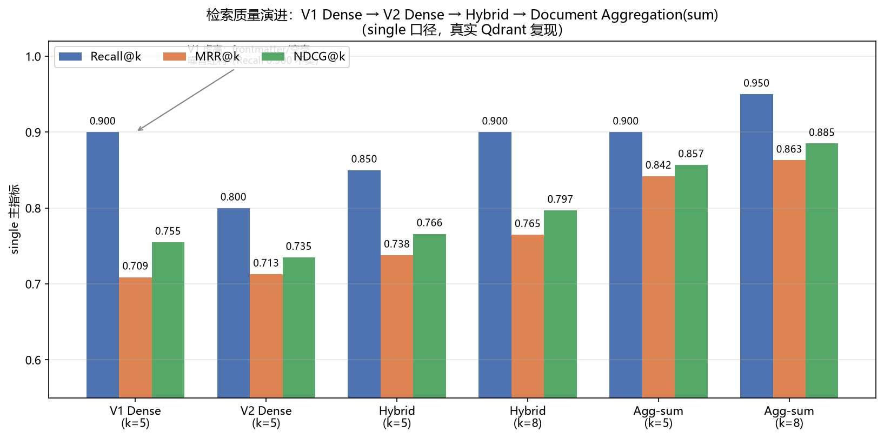
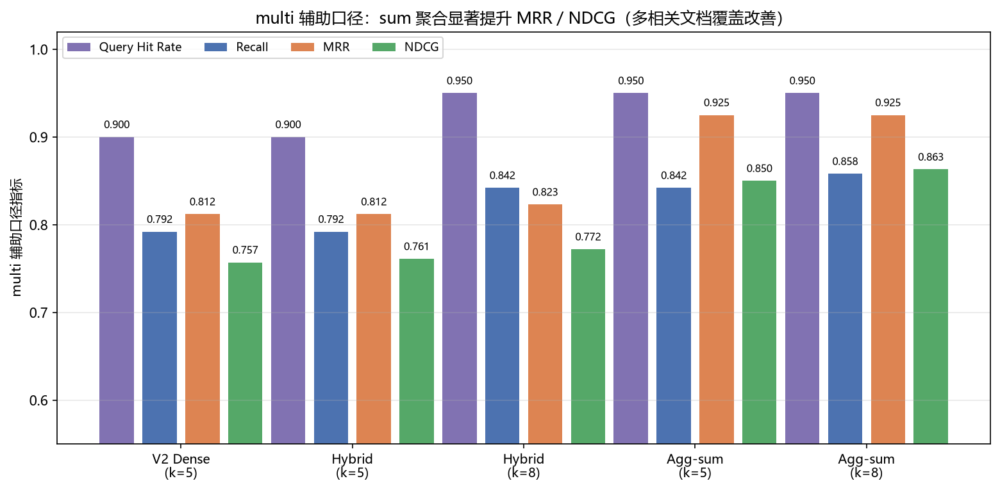
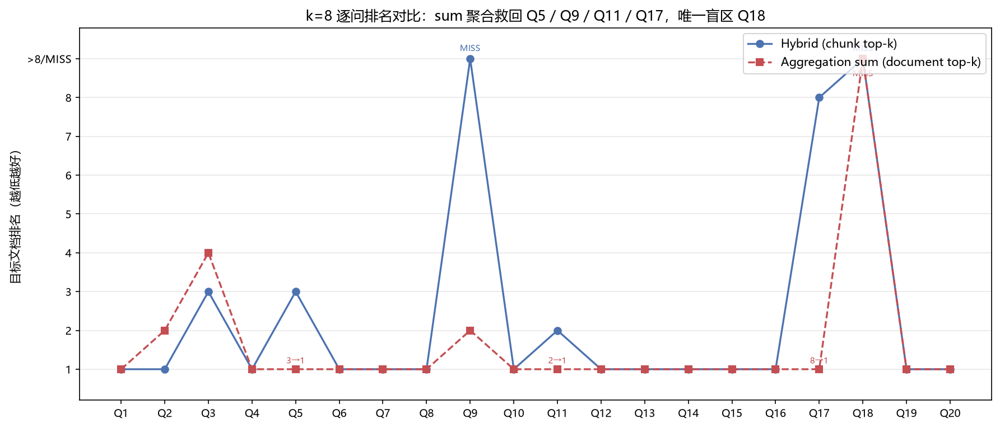

# KamaClaude 个人知识助手 RAG — 实现总结与改进方向

> 状态：**V1 基础链路 → V2 Chunker/信号改良 → Hybrid Search → Document Aggregation 四阶段全部完成** · 187 篇知识文档双索引同步（Qdrant + FTS5）· 可复现数值对比已建立（single 主口径 + multi 辅助口径）
> 更新：2026-10-07（Document Aggregation A/B 与逐问验证已并入）
> 数据来源：`eval_baseline.md` / `eval_aggregation.md` / 真实 Qdrant 复跑输出，均可在附录命令下复现

---

## 一、项目背景与总体目标

把 187 篇个人知识文档（LLM/Agent 学习资料、面试题集、技术书籍章节）变成**可检索、可追问、可持续改进**的知识库：

- **检索质量可量化**：建立 20 问 golden 集（人工标注预期文档，6 题标注多个相关文档），用 Recall / MRR / NDCG 度量；
- **每一处改进都有受控对比**：同索引、同 golden、同口径，A/B 证明后才接入生产；
- **检索链路与 Agent 架构解耦**：AgentLoop 零修改，KnowledgeService 独立演进。

**评测口径**（贯穿全部阶段）：
- **single（主指标）**：命中 `expected_doc` 才算相关；
- **multi（辅助指标）**：命中任一 `related_docs` 即相关（仅 Q2/Q3/Q9/Q16/Q18/Q19 多答案）；
- 匹配为 document 级（同文档重复 chunk 只计首次）；`Query Hit Rate` 与严格 `Recall` 分离（多标签题普遍只召回 1 个相关文档时，两者不同）。

---

## 二、更改思路：四个阶段的演进脉络

### 阶段 1：V1 基础实现（先跑通全链路）

**做了什么**：Dense 检索（Qdrant Local + bge-small-zh-v1.5，512 维 cosine）+ SQLite Document Catalog + 简单 chunker + content_hash 增量入库。

**暴露的问题**（评测后才看清）：
- frontmatter 的 title/description 被当作正文切进 chunk，产生 **109 个空壳 chunk**（只有元数据没有正文）；
- 整段正文一刀切，**126 个 chunk 超过 1600 字符窗口**，长段落被粗暴截断；
- 指标 **Recall@5 = 0.900 是"虚高"**——正是 frontmatter/空壳噪音带来的语义假命中。

**教训**：先跑通 → 用受控评测暴露质量问题，而不是凭感觉继续调。

### 阶段 2：V2 Chunker 与检索信号改良（质量）

**为什么改**：V1 的结构性缺陷（空壳、截断、噪音）已被评测量化。

**怎么改**：
1. **Markdown Heading Section 切分**：按 `##` 标题分段，段落边界优先，1600 字符窗口 + 200 字符 overlap，超长 section 才按段落拆；
2. **忽略 frontmatter**：元数据不再进入正文 chunk；
3. **过滤空壳**：过短/空 chunk 清零；
4. **检索信号注入**：embedding 输入从"纯正文"改为 `title + section + description + keywords + tags + body` 组合，保留文档级语义信号。

**效果**：chunk 质量全面改善（见 3.1），但 Recall 从 0.900 降到 0.800——**虚高水分被挤掉，指标更诚实**。同时暴露两个真问题：Q16/Q18 纯向量召不回（精确术语盲区）、Q9 大部头霸榜（结果多样性不足）。

### 阶段 3：Hybrid Search（精确信号）

**为什么改**：Q16（幻觉治理）/ Q18（框架对比）是**专有名词/精确术语型查询**，Dense 语义近邻召不回，需要词法精确匹配补位。

**怎么改**：
1. **SQLite FTS5 trigram 索引**：中文默认分词（unicode61）会把整句当 1 个 token，改用 trigram tokenizer（本机 SQLite 3.53.1 支持，运行时探测降级）；
2. **query 侧 trigram 化**：首次实验 Hybrid 与 Dense 完全相同——根因是 FTS 把整句当精确短语、真实问题与文档原文不一致 → 候选为空；改为提取 3 字 trigram 用 OR 匹配后生效；
3. **BM25 打分**：`bm25()` 函数排序，权重 title/section/content = 1.5/1.2/1.0（命中才加权）；
4. **RRF 融合**：`score = Σ 1/(60 + rank)`，不依赖 Dense/BM25 分数可比性；候选池每路 2×top_k，避免单路 Top-K 提前丢失；
5. **双索引生命周期同步**：index/delete/reindex 同时维护 Qdrant + FTS5，`_INDEX_STRATEGY` 拼入 `fts5:trigram:v1` 实现版本化重建。

**效果**：Q16 双口径救回（k=8 rank1）；single Recall/MRR/NDCG 全面提升（见 3.2）。代价：Q5/Q11 退到 rank2、Q17 k=5 退化——trigram OR 引入的竞争文档挤占部分向量结果（融合的固有 trade-off）。

### 阶段 4：Document Aggregation（结果多样性）

**为什么改**：Q9 中 `chapter10.md`（51 chunks 的大部头）在 chunk top-k 里霸榜 5~6 席，**目标文档一个 chunk 都进不去**——RRF 只融合排名、不解决"同一个文档占多个席位"的问题。

**怎么改**（先独立 A/B，后接入生产）：
1. **评估验证**：每路 2×k 候选 → 完整 RRF（不截断）→ 按 `document_id` 分组 → 三种聚合函数 A/B：
   - `sum`：文档内所有 chunk 的 RRF 分数求和（奖励"多个 section 都相关"的广泛信号）；
   - `max`：取最高分 chunk（只看最强一击）；
   - `first-seen`：取首个出现 chunk 的分数；
2. **生产接入（opt-in）**：`HybridRetriever(document_aggregation=...)`，默认 `None` 保持原始 chunk top-k；**生产路径只开放 `sum`**，`max`/`first-seen` 未验证不进入运行链路；配置 `[knowledge] document_aggregation = "sum"` 或环境变量启用。

**效果**：Q9 霸榜结构性缓解（chapter10 单席，k=8 目标文档排第 2）；single 指标全面超过 Hybrid baseline；**意外收获**：Q17（8→1）、Q5/Q11（回到 rank1）等融合代价题被文档级信号一并救回（见 3.4）。

---

## 三、结果提升对比（数据 + 图）

### 3.1 Chunker 结构对比（V1 → V2）

| 指标 | V1 | V2 | 说明 |
|---|---:|---:|---|
| 文档数 | 187 | 187 | 同一数据集 |
| 总字符数 | 1,581,107 | 1,581,107 | 同一数据集 |
| Section 数 | 3,066 | 3,066 | 按标题切分 |
| Chunk 数 | 3,237 | 2,989 | -248 |
| 空壳/空 Chunk | 109 | **0** | 清零 |
| >1600 字符窗口 | 126 | — | 段落边界切分消化 |
| 平均 Chunk 长度 | 497 | 514 | 更饱满 |
| 中位数长度 | 395 | 412 | 分布更均匀 |
| 完整窗口 Chunk | 17 | 21 | 长 section 保留 |

### 3.2 single 主口径：六阶段指标演进

| 阶段 | Recall@k | MRR@k | NDCG@k | 说明 |
|---|---:|---:|---:|---|
| V1 Dense (k=5) | 0.900 | 0.709 | 0.755 | **虚高**：frontmatter/空壳噪音红利 |
| V2 Dense (k=5) | 0.800 | 0.713 | 0.735 | 挤水分，指标诚实化 |
| Hybrid (k=5) | 0.850 | 0.738 | 0.766 | BM25 精确信号补位 |
| Hybrid (k=8) | 0.900 | 0.765 | 0.797 | 更多候选 |
| **Agg-sum (k=5)** | **0.900** | **0.842** | **0.857** | 文档级广泛信号 |
| **Agg-sum (k=8)** | **0.950** | **0.863** | **0.885** | 最优配置 |



**读图要点**：V1→V2 的 Recall 下降是"去虚高"；V2→Hybrid→Agg-sum 的三步提升是真实的检索质量改善；Agg-sum k=8 达到 Recall 0.950（20 问中 19 问命中）、MRR 0.863、NDCG 0.885。

### 3.3 multi 辅助口径（多相关文档覆盖）

| 阶段 | Hit Rate | Recall | MRR | NDCG |
|---|---:|---:|---:|---:|
| V2 Dense (k=5) | 0.900 | 0.792 | 0.812 | 0.757 |
| Hybrid (k=5) | 0.900 | 0.792 | 0.812 | 0.761 |
| Hybrid (k=8) | 0.950 | 0.842 | 0.823 | 0.772 |
| Agg-sum (k=5) | 0.950 | 0.842 | 0.925 | 0.850 |
| Agg-sum (k=8) | 0.950 | 0.858 | 0.925 | 0.863 |



**读图要点**：multi 口径下 Agg-sum 的 MRR 从 0.823 → **0.925**、NDCG 从 0.772 → **0.863**——sum 聚合不仅提升主口径，多相关文档的排序质量也显著改善（Q3/Q9 的多标签命中更靠前）。

### 3.4 k=8 逐问排名对比（Hybrid vs Agg-sum）



| Q | 问题 | Hybrid k=8 | Agg-sum k=8 | 变化 |
|---|---|---:|---:|---|
| Q5 | 多头注意力计算 | 3 | **1** | 提升 |
| Q9 | 多 Agent 通信 | MISS | **2** | **解决**（霸榜缓解）|
| Q11 | MCP 协议 | 2 | **1** | 提升 |
| Q16 | 幻觉治理 | 1 | 1 | 保持救回 |
| Q17 | 微调 vs RAG | 8 | **1** | **大幅提升** |
| Q18 | Agent 框架对比 | MISS | MISS | **未解决**（唯一盲区）|
| Q2 | ReAct 循环 | 1 | 2 | 轻微下降 |
| Q3 | RAG 核心思路 | 3 | 4 | single 略降 / multi 2→1 提升 |
| Q1/Q4/Q6/Q7/Q8/Q10/Q12-Q16/Q19/Q20 | 其余 13 题 | 1 | 1 | 保持 |

**逐问验证结论**：
- **解决的**：Q9（k=8 目标文档从 MISS 到 rank2，chapter10 从 6 席压到 1 席）；Q17（8→1，`finetuning_vs_rag.md` 的多 chunk 分数累积后登顶）；Q5/Q11（回到 rank1，融合代价消失）；Q16 保持救回；
- **代价**：Q2 从 rank1 微降 rank2、Q3 single 略降（但 multi rank1 保持——Q3 本就是 golden 单标签局限，多口径已正名）；
- **未解决**：Q18 双口径均 MISS——Dense 与 trigram 都召不回 `agent_framework_comparison.md`，**确认是术语/关系型查询盲区，检索器调整到头，指向 Query Rewrite**。

### 3.5 P1 复核：固定候选池 + 4000 token 输出预算（进上下文内容对比）

**实验目的**：排序指标（Recall/MRR/NDCG）只度量"排序质量"，不度量"LLM 实际能读到什么"。P1 用**生产完全一致**的链路验证：固定候选池（每路 2×k=16）+ 完整 RRF + 两种输出方式（chunk top-k vs sum 聚合 document top-k）+ **bge tokenizer 真实计数**的 4000 token 预算格式化（`format_results` 逻辑）。

| 方法 | Budget-Hit (single) | Budget-Hit (multi) | 平均进 context 文档数 | 平均消耗 token | 目标文档平均 token |
|---|---:|---:|---:|---:|---:|
| chunk-top-k | 18/20 (0.90) | 19/20 (0.95) | 2.9 | 3106 | 1770 |
| **sum 聚合** | **19/20 (0.95)** | 19/20 (0.95) | **5.9** | **2638** | 394 |

**结论**：
1. **sum 在预算层面多救回 Q9**（唯一 0→1 改善题）：chunk 方式目标文档进不了上下文，sum 方式第一次进入；
2. **多样性翻倍**：进 context 的不同文档平均 2.9 → **5.9**（chunk top-8 常集中在 1~3 本大部头；sum 后 8 本各一段）；
3. **token 更省**：平均 3106 → **2638**（sum 用更少预算覆盖更多文档）；
4. **Q18 两种方式均为 0**：确认与预算/聚合无关，是纯召回盲区（Query Rewrite 的靶子）。

**P1 结论：sum 聚合在"排序质量"与"实际可用内容"双层面成立，可安全作为默认候选策略；Q9 文档频率偏置问题闭环解决。**

---

## 四、问题解决情况对照

| 文档此前记录的问题 | 阶段归属 | 现状 |
|---|---|---|
| V1 空壳/截断/噪音导致 Recall 虚高 | V2 Chunker | ✅ 挤水分 + 空壳清零 |
| Q16/Q18 精确术语召不回 | Hybrid Search | ✅ Q16 救回（k=8 rank1）；❌ Q18 未解 |
| Q9 大部头 chunk 霸榜、结果多样性不足 | Document Aggregation | ✅ 单文档单席；k=8 目标文档 rank2（k=5 仍 MISS）|
| Q5/Q11 融合代价（rank1→2）| Document Aggregation | ✅ 回到 rank1（文档级信号抵消 lexical 竞争）|
| Q17 k=5 退化 | Document Aggregation | ✅ k=5/k=8 均 rank1 |
| Q18 框架对比盲区 | — | ❌ 待 Query Rewrite（唯一剩余硬缺陷）|

---

## 五、当前生产状态与配置

| 项目 | 状态 |
|---|---|
| 默认检索路径 | Hybrid chunk top-k（`document_aggregation=None`），实测 0.900/0.765/0.797（k=8）|
| 可选策略 | `document_aggregation = "sum"`（opt-in，默认关闭），实测 0.950/0.863/0.885（k=8）|
| 已拒绝进入生产 | `max` / `first-seen`（未验证的排序策略不进运行链路）|
| 边界保持 | AgentLoop 零修改；KnowledgeService 不直接实现 FTS/RRF/聚合；`max_retrieved_tokens=4000` 预算不变 |

启用方式：

```toml
[knowledge]
hybrid_enabled = true
document_aggregation = "sum"
```

或环境变量 `KAMA_KNOWLEDGE_DOCUMENT_AGGREGATION=sum`；省略/空/`none`/`null` 保持原始 chunk top-k。

**重要边界（不把"去重"说成"提升"）**：聚合改变的是最终 Top-K 的**构成**（哪些文档、哪些代表 chunk 进上下文，每个文档只带一个代表 chunk，受 4000 token 预算约束），指标变化反映完整实验链路的结果。接入生产前仍需固定候选池/输出预算的复核实验。

---

### 5.5 真实 Agent 端到端验证凭证（真实 daemon + 真实 LLM，2026-10-07）

**环境**：`~/.kama/config.toml`（knowledge enabled + hybrid + `document_aggregation="sum"`）+ `.env`（真实 LLM：`deepseek-v4-pro` via ）+ 真实 daemon（`kama-core` 监听 127.0.0.1:7437）+ CLI/TUI 客户端。知识库 187 文档、2989 向量已索引。

**验证方式**：在真实 Agent 会话中直接提问，观察（1）自动检索注入；（2）LLM 是否自主调用 `knowledge_search`（改查询词）；（3）是否 `read_file` 读知识库原文；（4）回答是否引用知识库内容。全程记录在 daemon trace（`~/.kama/traces/daemon.jsonl`）。

#### 凭证 1：Q9 主题查询（通信协作）——全链路生效

- 用户问题：`多智能体系统中 agent 之间如何通信与编排？`
- 过程（CLI 输出）：
  - step 1 `in=7204`：自动检索注入（`retrieved_context` 8515 字符进 system prompt，命中 Q9 目标文档 chapter10.md）
  - step 1 `knowledge_search` ×2：`query='多智能体 agent 通信 编排 架构'`、`query='multi-agent 通信 编排 orchestrator 消息传递 产物交换'`（LLM 自主中英改写）
  - step 2 `read_file` ×3：`kamacoder_llm\docs\interview\ll…`、`kamacoder_llm\docs\llm\app\mul…`、`深入理解AI-Agent_李博杰\chapter10.md`（Q9 目标文档）
- 结果：`✓ completed 3 steps`，`tokens in=32273 out=2234 cache=19840 ctx:16.1%`
- 回答证据（知识库特有内容）："书籍翻译 Glossary Agent 写术语表、Transl Agent 读取"（chapter10 案例）、"OpenAI Swarm handoff、MetaGPT 消息池"、"A2A 与 MCP 对照"、"Token 预算分级收束"、"没有新信息，多 Agent 往往只是更贵的单 Agent"（核心判据）。

#### 凭证 2：Q18 主题查询（框架异同）——离线评测三层 MISS，真实链路被 LLM 自主改写救回

- 用户问题：`主流 Agent 框架有什么异同`（离线评测 Dense/trigram/聚合三层均 MISS，见 3.2/3.4）
- 过程（daemon trace，run_id=`20261007-105801-83f188`）：
  - step 1 LLM **自主改写查询 ×2**：
    - `knowledge_search query='主流 Agent 框架对比 LangChain CrewAI AutoGen Claude Code 编排模式 适用场景'`
    - `knowledge_search query='Agent 框架选型 LangGraph CrewAI AutoGen MetaGPT 区别'`
  - knowledge_search 返回：`OpenClaw、Hermes Agent、Claude Code三框架横评…` 等
  - step 2 `read_file`：**`agent_framework_comparison.md`（Q18 的 expected_doc，离线评测从未命中）** + 另一篇
- 结果：`✓ completed 3 steps`，`tokens in=13438 out=2516 cache=26112 ctx:6.7%`
- 回答证据：总览表（Codex Harness/Claude Agent SDK/LangGraph/CrewAI/AutoGen/Swarm/n8n/Dify/OpenClaw/MetaGPT）+ 三条轴（编排模式/通信协作/产品级深挖）+ 选型 + "Harness 是落地关键"，内容与 `agent_framework_comparison.md` 的 expected section（"架构对比：底层设计思路有什么不同"）一致。

#### 凭证结论

1. **检索 → 工具 → 读原文 → 综合回答，全链路在真实对话中生效**，LLM 主动使用 `knowledge_search` 并改写查询词；
2. **Q18 离线 MISS ≠ 知识库无内容，而是查询表达问题**：原问题太泛，单次向量检索抓不住"框架对比"意图；LLM 改写成具体框架名后命中——**Query Rewrite 方向获得真实链路证据**；
3. **离线评测（静态检索上限）与真实 Agent（动态改写+多轮检索）存在口径差异**，后续 Query Rewrite 评测可增加"改写后查询命中率"基准；
4. 附带修复：Windows 平台 `app.py` 的 `loop.add_signal_handler` 不支持（NotImplementedError），已加平台兼容处理（try/except 兜底，Ctrl+C 走 KeyboardInterrupt）。

---

## 六、结论与后续方向

**阶段结论**：
1. **改进路径有效**：V2 挤水分 → Hybrid 补精确信号 → Aggregation 加文档级信号，三步各有实证（single Recall 0.800 → 0.900 → 0.950）；
2. **sum 聚合是当前最优**：唯一在 single/multi 双口径都不输 basline 的聚合，且意外修复 Q5/Q11/Q17 三个融合代价题；
3. **Q18 是最后一块硬骨头**：Dense + trigram + 聚合三层都召不回，必须靠 Query Rewrite（查询改写/术语规范化）而非继续调检索器。

**后续优先级**：

| 优先级 | 改进项 | 目标 | 验证方式 | 状态 |
|---|---|---|---|---|
| P1 | 固定候选池/输出预算复核 sum | 确认聚合收益来源（进 context 的内容形态）| 同候选池 + 4000 token 预算对比 | ✅ 已完成（见 3.5：预算内多救回 Q9、多样性 2.9→5.9 本、token 3106→2638，双层面成立）|
| P2 | Query Rewrite（查询改写/术语规范化）| Q18 及同类专名/关系型查询 | 同一 golden 集，观察 Q18 是否进入 top-k | 下一优先级 |
| P3 | Reranker（cross-encoder 精排）| 位次靠后题目 | NDCG 进一步提升后评估 | 待 P2 后评估 |
| P3 | section 级评估 | 定位到具体 section | 评估粒度细化 | 待定 |

---

## 附录：复跑命令与文件清单

```powershell
# 检索基线（dense / hybrid，k=5 / k=8）
& D:\tinyclaude\.venv\Scripts\python.exe D:\tinyclaude\knowledge_docs\eval_rag.py 5 dense
& D:\tinyclaude\.venv\Scripts\python.exe D:\tinyclaude\knowledge_docs\eval_rag.py 5 hybrid
& D:\tinyclaude\.venv\Scripts\python.exe D:\tinyclaude\knowledge_docs\eval_rag.py 8 dense
& D:\tinyclaude\.venv\Scripts\python.exe D:\tinyclaude\knowledge_docs\eval_rag.py 8 hybrid
# Document Aggregation A/B（顺序执行，避免 Qdrant 锁竞争）
& D:\tinyclaude\.venv\Scripts\python.exe D:\tinyclaude\knowledge_docs\eval_rag_aggregation.py 5 hybrid
& D:\tinyclaude\.venv\Scripts\python.exe D:\tinyclaude\knowledge_docs\eval_rag_aggregation.py 8 hybrid
# 全量双索引入库（content_hash 断点续传）
& D:\tinyclaude\.venv\Scripts\python.exe D:\tinyclaude\knowledge_docs\index_knowledge.py
```

| 文件 | 用途 |
|---|---|
| `src/kama_claude/core/knowledge/retriever/dense.py` | DenseRetriever（Qdrant 向量检索）|
| `src/kama_claude/core/knowledge/retriever/bm25.py` | BM25Retriever（FTS5 lexical 检索）|
| `src/kama_claude/core/knowledge/retriever/lexical_store.py` | FTS5 trigram 索引与查询（scope 过滤）|
| `src/kama_claude/core/knowledge/retriever/fusion.py` | RRF 融合 + document 聚合（独立可测）|
| `src/kama_claude/core/knowledge/retriever/hybrid.py` | HybridRetriever（双路并行 + 降级 + 聚合开关）|
| `src/kama_claude/core/knowledge/service.py` | 双索引生命周期同步 + Retriever 注入 |
| `src/kama_claude/core/config.py` / `app.py` | hybrid/aggregation 配置 + 初始化降级 |
| `knowledge_docs/eval_rag.py` | dense/hybrid 受控评测（双口径）|
| `knowledge_docs/eval_rag_aggregation.py` | 聚合 A/B 评测（sum/max/first-seen + chunk-top-k 控制组）|
| `knowledge_docs/golden_set.json` | 20 问 ground truth（6 题 related_docs）|
| `knowledge_docs/eval_baseline.md` | Dense/Hybrid 受控对比基线表 |
| `knowledge_docs/eval_aggregation.md` | 聚合 A/B 结果与决策记录 |
| `knowledge_docs/eval_stage_metrics.png` / `eval_perq_rank_k8.png` / `eval_multi_metrics.png` | 本文件配图（对比数据可视化）|

运行时数据：`~/.kama/knowledge/`（qdrant 2989 向量 512 维 cosine + catalog.db 187 条 ready + lexical.db 2989 rows，FTS5 trigram，bm25 权重 1.0/1.2/1.5）；模型 `~/.cache/huggingface/hub/models--BAAI--bge-small-zh-v1.5`（512 维）。
